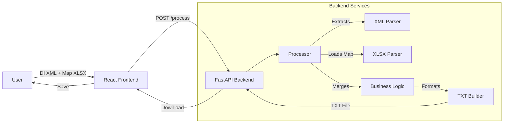

# System Architecture & Design

This document details the technical architecture of the **Emissor NFSe from DI** system.

## 1. Architecture Overview

The system is a **stateless file processing pipeline** exposed via a web interface.

- **Frontend (UI)**: React + TypeScript. Handles file selection, validation feedback, and download initiation.
- **Backend (API)**: Python (FastAPI). Performs the heavy lifting of parsing, transformation, and formatting.

## 2. Technology Stack

- **Frontend**: React, Vite, TailwindCSS, Lucide Icons.
- **Backend**: Python 3.11+, FastAPI, Uvicorn.
- **Libraries**:
  - `xmltodict`: For converting DI XML to Python dictionaries.
  - `openpyxl`: For reading/writing Excel mapping files.
  - `pydantic`: For data models and validation.

## 3. Data Processing Pipeline

### 3.1. Parsing Strategy

- **DI XML**: Parsed using `xmltodict`.
  - **Schema Compliance**: Adheres to the **[Esquema (XSD) do XML da Consulta](https://www.gov.br/receitafederal/pt-br/assuntos/aduana-e-comercio-exterior/manuais/despacho-de-importacao/sistemas/siscomex-importacao-web/declaracao-de-importacao/funcionalidades/links-para-arquivos/esquema-xsd-do-xml-da-consulta.pdf)**.
  - _Key Entities_: Header (DI Number, Dates, Importer, Cargo), Items (Adições -> Mercadorias).
- **Mapping XLSX**: Parsed using `openpyxl`.
  - _Key_: NCM Code (8 digits).
  - _Value_: Internal Product Code, CFOP, Custom Output Unit.

### 3.2. Data Merging (The "Processor")

The `Processor` service implements a **Left Join** logic:

1.  Iterate through every Mercadoria/Item in the DI XML.
2.  Clean the NCM (remove dots).
3.  Look up the NCM in the loaded XLSX mapping.
4.  If found: Attach `Internal Code` and `CFOP` to the item.
5.  If not found: Raise a validation error (blocking the process to ensure data integrity).

### 3.3. Output Generation (The "Formatter")

The output is a **Fixed-Width Text File** following the **"Layout - Nota Fiscal 2"** specification (proprietary ERP format).

> **Note**: This is distinct from the [Leiaute do TXT da DI](https://www.gov.br/receitafederal/pt-br/assuntos/aduana-e-comercio-exterior/manuais/despacho-de-importacao/sistemas/siscomex-importacao-web/declaracao-de-importacao/funcionalidades/links-para-arquivos/leiaute-do-txt-da-di.doc) provided by Siscomex. We convert _from_ Siscomex XML _to_ this specific ERP TXT layout.

- **File Structure**:
  - **Header Record (Type 1)**: 380 characters. Contains summary data (Importer, Totals, Dates).
  - **Item Records (Type 2)**: 688 characters per item. Contains product details, tax rates, and values.
- **Formatting Rules**:
  - **Numeric (N)**: Zero-padded left, explicit dot separator for decimals (e.g., `000150.00`).
  - **Alpha (A/C)**: Space-padded right (e.g., `TEXT      `).
  - **Dates**: `AAAAMMDD` or `DDMMAA` depending on the specific field.

## 4. Key Components

### 4.1. `backend/parsers/xml_parser.py`

- Responsible for navigating the complex DI XML tree.
- Normalizes lists (handling cases where XML converts single items to dicts and multiple items to lists).
- Extracts tax fields (II, IPI, PIS, COFINS) from nested structures.

### 4.2. `backend/formatters/txt_builder.py`

- Implements the "Nota Fiscal 2" layout.
- Contains the logic for field positioning and padding.
- **Note**: This component must be strictly synchronized with `format_guidelines/NOTA_FISCAL_2_CONTEXT.md`.

## 5. Domain Knowledge

### 5.1. DI (Declaração de Importação)

A federal document. The parsing logic relies on definitions found in the [Dicionário de Dados da DI](https://www.gov.br/receitafederal/pt-br/assuntos/aduana-e-comercio-exterior/manuais/despacho-de-importacao/sistemas/siscomex-importacao-web/declaracao-de-importacao/funcionalidades/links-para-arquivos/dicionario-de-dados-da-di.doc) and [Adição](https://www.gov.br/receitafederal/pt-br/assuntos/aduana-e-comercio-exterior/manuais/despacho-de-importacao/sistemas/siscomex-importacao-web/declaracao-de-importacao/funcionalidades/links-para-arquivos/dicionario-de-dados-da-adicao.doc). Focuses on extracting Commercial Quantity, Unit Value, Total Value, and Tax Rates.

### 5.2. NCM (Nomenclatura Comum do Mercosul)

The primary key used to link the Federal data (XML) with the Company data (Excel).

## 6. Future Improvements

- **Validation**: Implement XSD validation using `lxml` for stricter input checking.
- **Database**: Add a local database to persist mappings so the user doesn't need to upload the Excel file every time.
