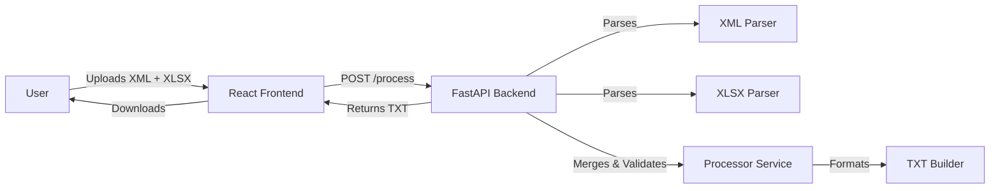

# System Architecture & Design

This document provides a comprehensive overview of the **Emissor NFSe from DI** system, covering its architecture, data flow, specifications, and component design.

## 1. High-Level Architecture

The system follows a simple **Client-Server** architecture designed for stateless file processing.

- **Frontend**: A Single Page Application (SPA) built with React and Vite. It serves as the user interface for file file uploads (XML & XLSX) and downloading the processed result.
- **Backend**: A RESTful API built with FastAPI (Python). It handles the core business logic: parsing, data merging, validation, and formatting.



## 2. Technology Stack

### Frontend

- **Framework**: React (Vite)
- **Language**: TypeScript
- **Styling**: Tailwind CSS
- **HTTP Client**: Native `fetch` (inferred)

### Backend

- **Framework**: FastAPI
- **Language**: Python 3.x
- **Server**: Uvicorn
- **Key Libraries**:
  - `xmltodict`: For XML parsing.
  - `pandas` / `openpyxl`: For Excel processing.
  - `pydantic`: For data validation (potential use, mostly standard typing used).

## 3. System Flow

1.  **Template Download**: User downloads a standard Excel template (`/template`) to map NCM codes to internal product codes and CFOPs.
2.  **File Selection**: User selects the _Declaração de Importação_ (DI) XML file and the filled Mapping XLSX file.
3.  **Upload**: Frontend sends both files as `multipart/form-data` to the `/process` endpoint.
4.  **Processing**:
    - Backend validates file extensions.
    - **XML Parsing**: Extracts header info (DI Number, Date) and line items (Adições, Mercadorias).
    - **Mapping Loading**: Reads the Excel file into a lookup dictionary (Key: NCM).
    - **Data Merging**: For each item in the XML, the system looks up its NCM in the mapping to find the corresponding `Internal Code`, `CFOP`, and `Output Unit`.
    - **Validation**: Checks if NCMs exist in the mapping and if required fields are present. Errors are collected and raised if any match fails.
    - **Text Generation**: Converts the merged data into a strict fixed-width text format required by the target system.
5.  **Response**: The generated TXT file is streamed back to the client.
6.  **Download**: Browser prompts the user to save the file (e.g., `Processado_DI12345.txt`).

## 4. Dataflow & Data Specifications

### 4.1. Inputs

#### A. DI XML (`.xml`)

Standard _Declaração de Importação_ format.

- **Key Path**: `<declaracaoImportacao>`
- **Header Data**:
  - `numeroDI`: Import Declaration Number.
  - `dataRegistro`: Registration Date.
- **Item Data** (`<adicao>` -> `<mercadoria>`):
  - `numeroAdicao`: Addition Number.
  - `dadosMercadoriaCodigoNcm`: NCM Code.
  - `descricaoMercadoria`: Product Description.
  - `quantidade`: Commercial Quantity.
  - `unidadeMedida`: Commercial Unit.
  - `valorUnitario`: Unit Value.
  - `valorTotalCondicaoVenda`: Total Value.

#### B. Mapping XLSX (`.xlsx`)

A simple lookup table to enrich the XML data with internal system codes.

- **Columns**:
  - `NCM` (Key): The taxonomy code matching the XML.
  - `Internal Code`: The SKU/Product ID in the target ERP/System.
  - `CFOP`: Código Fiscal de Operações e Prestações.
  - `Output Unit` (Optional): Unit to be used in output if different from XML.

### 4.2. Output

#### Processed TXT (`.txt`)

A fixed-width text file with massive positional formatting.

- **Structure**:
  - **Header (Record 1)**: Contains summary info (Note Number, Dates, Totals, Exporter Name).
    - Example fields: `Tipo`, `Emp`, `Filial`, `Nota`, `Total Merc`, `Nome Exp`.
  - **Items (Record 2)**: One line per product/mercadoria.
    - Example fields: `NCM` (8 chars), `Internal Code` (22 chars), `Qty` (13,3 format), `Unit Value` (15,5 format), `Description` (100 chars).

**Data Transformation Logic**:

- **NCM**: Stripped of non-numeric characters, truncated to 8 digits.
- **Numbers**: Formatted with precise decimal places (e.g., `15,5` means 15 total chars, 5 decimal places), zero-padded (left) or space-padded depending on field type.
- **Strings**: Truncated/padded to specific lengths.

## 5. System Design (Backend)

The backend is structured as a modular service-oriented application.

```
backend/
├── app.py                  # Entry point, Routes
├── parsers/
│   ├── xml_parser.py       # XML -> List[Dict]
│   └── xlsx_parser.py      # XLSX -> Dict[NCM, Data]
├── services/
│   ├── processor.py        # Business Logic (Merge & Validation)
│   └── generator.py        # Template generation
└── formatters/
    └── txt_builder.py      # Dict -> Fixed-Width String
```

### Key Components

1.  **`xml_parser.parse_di_xml(bytes)`**
    - Uses `xmltodict` to flatten the nested XML structure.
    - Handles list/dict polymorphism (single item vs list of items).
    - Returns a flat list of items enriched with parent context (DI info).

2.  **`services.processor.process_file_data(xml, xlsx)`**
    - The "Controller" logic.
    - Calls parsers.
    - Performs the **Join Operation**: `Left Join` on XML Items using NCM as the key.
    - Accumulates errors (e.g., "NCM X not found in mapping") to provide a single comprehensive error message.

3.  **`formatters.txt_builder`**
    - Contains the strict spec definitions.
    - `FixedWidth` class handles the low-level string manipulation (padding, decimal formatting).
    - `build_txt_content` maps the internal dictionary keys to the specific fixed positions of the output file.
